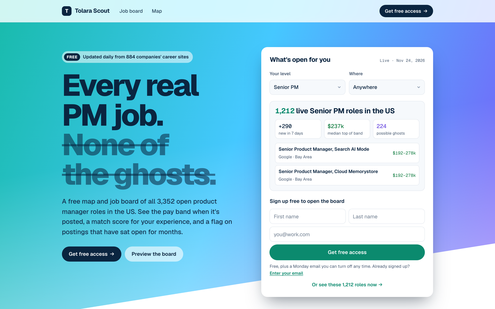
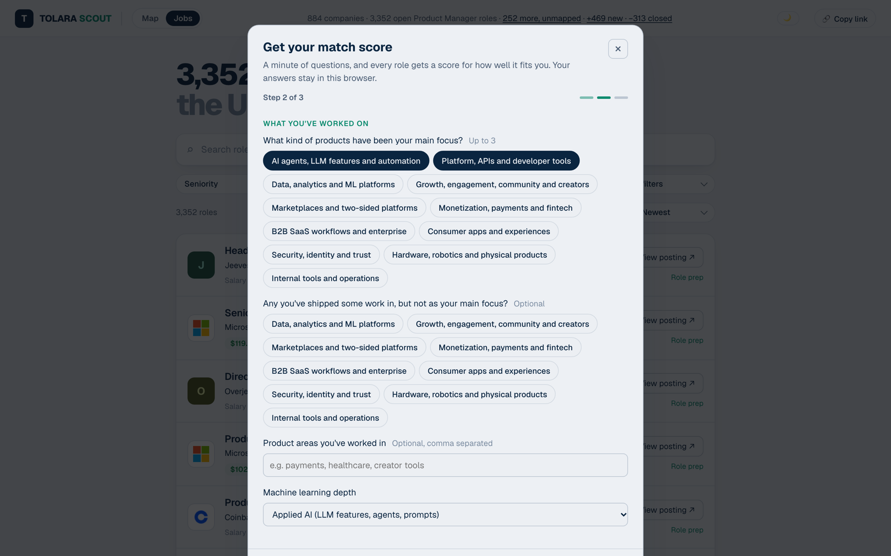
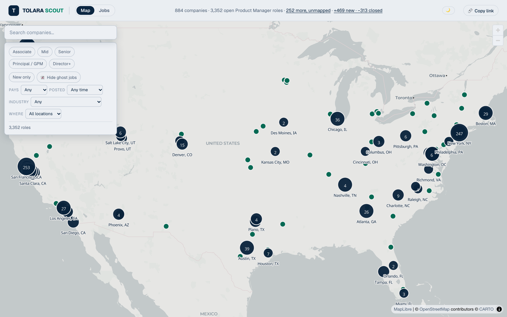
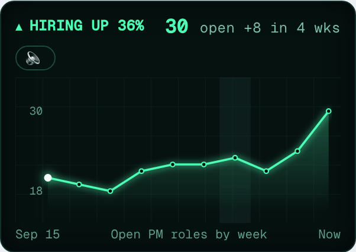

<div align="center">

# Tolara Scout

### Every open Product Manager job in the US. One board, one map, the real pay.

**Updated daily, straight from 1,606 companies' own careers sites. Free.**

<a href="https://gabethegeek.github.io/tolara-atlas/"></a>
&nbsp;
<a href="#run-it-yourself"></a>

[](https://github.com/GabeTHEGeek/tolara-atlas/actions/workflows/sync.yml)


<a href="https://gabethegeek.github.io/tolara-atlas/"></a>

| **3,352** | **884** | **72%** | **$210K** | **478** |
|:---:|:---:|:---:|:---:|:---:|
| open PM roles | companies hiring | show the real pay band | median PM pay | ghost jobs flagged |

</div>

> ⭐ **If this saves you an afternoon of tab-hopping, star the repo** and send
> it to a PM friend who's looking. That's how other PMs find it.

---

## A 60-second tour

<table>
  <tr>
    <td width="50%" valign="top">
      
      <p align="center"><b>📋 The board, sorted by fit.</b><br><sub>Every role with its pay band, how fresh it is, and your match score.</sub></p>
    </td>
    <td width="50%" valign="top">
      
      <p align="center"><b>🎯 A one-minute match quiz.</b><br><sub>No resume needed. Answers never leave your browser.</sub></p>
    </td>
  </tr>
  <tr>
    <td width="50%" valign="top">
      
      <p align="center"><b>🗺️ Who's hiring near you.</b><br><sub>One pin per office, sized by open PM roles.</sub></p>
    </td>
    <td width="50%" valign="top">
      
      <p align="center"><b>🧠 Prep for every role.</b><br><sub>Posted pay and how it ranks, leadership, company snapshot, news.</sub></p>
    </td>
  </tr>
</table>

<p align="center">
  <br>
  <sub><b>📈 The hiring pulse.</b> Every company's open PM roles, week by week, so you can see who's hiring <i>up</i>.</sub>
</p>

## What's new

**Late November 2026: a match quiz, ghost-job flags and a landing page.**
The board now covers **3,352 roles at 884 companies in 167 cities.**

- 👋 **A landing page** with live numbers. Everything on it (roles opened and
  closed this week, possible ghosts, pay by level, the newest roles for your
  level and city) is worked out from the same data file the board loads, so
  it updates with the daily sync. Signing up (first name, last name, email,
  sent straight to Kit) opens the board and adds you to the Monday email.
- 🎯 **A one-minute match quiz.** No resume needed: answer a few questions
  about your experience and what you want, and every role gets a match score.
  An animated ring next to each role shows how strong the match is.
- 👻 **Ghost-job flags.** Roles open 90+ days, or taken down, reposted and
  open 45+ days, are tagged *Possible ghost job*. One filter hides them all.
- 📈 **The hiring pulse** on every role page: the company's open PM roles by
  week, drawn like a heart monitor.
- 📋 **The job board is the home page.** The map is one click away at
  `#/map`, and old map links still work.
- 🌗 **A new light design,** with a switch for dark mode.
- 🏢 **170 more companies** from VC portfolio job boards (Accel, General
  Catalyst, Khosla, Insight, Thrive and 8VC), found with `npm run discover:vc`.
- 🎙️ **The voice copilot is now hidden by default.** Set `VITE_ENABLE_VOICE=1`
  in `.env.local` to turn it back on.

## Why this exists

Looking for a PM job means checking LinkedIn, Indeed and fifty careers pages,
and still not knowing:

- **Is this role still open?** Aggregators keep dead listings for months.
- **What does it pay?** Usually "competitive".
- **Who else is hiring in my city?** No job board shows you a map.
- **Am I a fit?** Keyword matching says yes to everything.

Tolara Scout answers all four. It reads 1,606 companies' own hiring pages
every day, so a role is here only while it's actually open, at the office
where it's actually based, with the pay band the company published. And when
a posting has been up so long it probably isn't a live search, it says so.

## Who's on it

**Big Tech:** Amazon · Google · Microsoft · Apple · Meta · NVIDIA · Netflix ·
TikTok · Oracle · Salesforce · Adobe · Workday · ServiceNow · HPE · Intel

**AI:** OpenAI · Anthropic · Perplexity · Scale AI · Glean · Sierra · Harvey ·
Mercor · Runway

**Fintech & banks:** JPMorgan Chase · Capital One · American Express ·
Mastercard · FanDuel · Stripe · Coinbase · Robinhood · Plaid · Ramp · Brex · Affirm

**Consumer:** Airbnb · Pinterest · Reddit · Roblox · Discord ·
Duolingo · DoorDash · Instacart · Lyft · Zillow · Expedia

**Software & data:** Snowflake · Databricks · Datadog · ServiceNow · Workday ·
Figma · Notion · Linear · Vercel · GitLab

…and 1,500 more. Don't see your company?
[Add it in one line](#add-a-company-in-one-line).

## PM pay, from real postings

Middle of the posted pay band, for the 2,401 roles that publish a yearly
band in USD:

| Level | Median |
|---|---|
| Associate / APM | **$106K** |
| Product Manager | **$200K** |
| Senior PM | **$209K** |
| Principal / Group PM | **$231K** |
| Director and above | **$239K** |

58% of banded roles pay $200K or more at the midpoint, and 150 pay $300K or
more. These are posted bands, not self-reported surveys.

**This week:** 469 roles added and 313 closed. The header shows what moved,
role by role. **478 open roles** are flagged as possible ghosts.

## What you get

📋 **A job board first.** Search by title, company or city. Filter by level,
pay, industry, remote and posting date. Every role is tagged 🔥 Hot, ✨ New,
🧊 Aging or 🥶 Stale, so you apply while it's fresh.

🗺️ **And a map.** One pin per office, sized by open roles. See who's hiring
PMs in Seattle, Austin or New York at a glance.

👻 **Ghost-job flags.** Roles open 90+ days, or reposted and still open after
45, are flagged, with the reason. Hide them with one filter.

🏷️ **18 industries.** AI labs, fintech, banks, health, gaming, devtools,
security and more. Narrow the whole board to the space you want.

🎯 **Match scores.** Take the one-minute quiz, or score every role against
your resume, on domain, company stage, level, hard requirements, location
and pay. Each score comes with one line of evidence, so you can see why.
Sort by *Best match* and start at the top. Quiz answers and resumes stay on
your machine.

🧠 **Interview prep for every role.** Company snapshot, leadership, recent
news, hiring trend, and what the role will actually focus on, quoted from
the posting.

🤝 **People to reach.** Find the hiring manager and team for a role, ranked
by how close they are to it. Runs locally, only when you ask.

📈 **A change feed.** Every role opened and closed in the last week, so you
spot a team's hiring push before everyone else does.

👋 **A landing page** with live numbers. A free signup opens the board and
adds you to the Monday email.

🎙️ **Talk to the map (optional, off by default).** *"Take me to New York."*
*"Only senior roles over $200K."* Answers come from the posting's own text,
not the model's memory.

## Ask your AI assistant

Tolara Scout has an [MCP server](mcp/), so Claude, Cursor or any MCP client
can search the board for you: *"Senior PM roles in New York over $200K,
newest first"*, *"What's Stripe hiring for?"*, *"What opened yesterday in
fintech?"*. It runs on your machine and reads the same public data as the
site, so there's no key and nothing to pay for.

| Tool | What it does |
|---|---|
| `search_roles` | Search by keywords, company, city, level, salary, remote, industry and posting age |
| `get_role` | One role: pay band and its rank for the level, days open, ghost-job flag, focus |
| `get_company` | A company's roles, weekly hiring trend, leaders and news |
| `whats_new` | Roles opened and closed in the last 1–7 days, for a daily digest |
| `tolara_overview` | Market totals, top cities and the industry list |

Setup is one line; see [mcp/README.md](mcp/README.md).

## Built to be trusted

- **Straight from the source.** Every role links to the company's own
  posting. No middlemen, no reposts, no sponsored listings.
- **Pay is parsed, never guessed.** `$257K – $335K`, `208,000 USD - 327,750
  USD`, `$57–$70 per hour`. A 401(k) match is never mistaken for salary.
- **A blank beats a guess.** If a posting doesn't say it, neither do we.
- **Free data only.** The daily sync has no paid dependencies.
- **Your data stays local.** Resumes, quiz answers, match scores and
  contacts stay on your machine (in the browser or a gitignored folder) and
  are never committed.
- **No keys in the page.** AI provider keys are read only by the local dev
  server and never reach the browser.

## Run it yourself

Requires **Node 22**.

```bash
git clone https://github.com/GabeTHEGeek/tolara-atlas.git
cd tolara-atlas
npm install
npm run dev         # http://localhost:5173
```

The repo ships with the latest data, so the board and map work immediately:
no API keys and no sync needed.

**Fork it for your own search.** Take the match quiz in the app, or point the
matcher at your resume and the board sorts itself by fit:

```bash
npx tsx scripts/match-resume.ts .local/resume.txt
```

**Optional settings.** Copy `.env.example` to `.env` for server-side keys,
and put browser settings in `.env.local` (both are gitignored):

- `VITE_KIT_FORM_ID`: the Kit form that landing-page signups go to. It's a
  public form ID, not a secret. Never put an API key in a `VITE_` variable:
  Vite copies every one of them into the public page.
- `VITE_ENABLE_VOICE=1`: shows the voice copilot.
- A model key in `.env` (Gemini's free tier works) powers the voice copilot
  and People to reach. Six providers are supported, and switching is one line.

<details>
<summary>All scripts</summary>

| Command | What it does |
|---|---|
| `npm run dev` | Dev server with the local APIs |
| `npm run sync` | Refresh every company's open roles |
| `npm run descriptions -- --minutes=20` | Fill in posting text and pay, time-budgeted |
| `npm run geocode` | Place each role on the map |
| `npm run prewarm` | Build company dossiers, time-budgeted |
| `npm run export` | Write the JSON the frontend reads |
| `npm run build` | Typecheck and build for production |
| `npm run discover` | Find more companies' job boards from community-maintained board lists |
| `npm run discover:a16z` | Find job boards from a16z's portfolio list |
| `npm run discover:vc` | Find job boards from VC portfolio job boards |
| `npm run find-people -- <role ids>` | Find people to reach for the roles you list |
| `npx tsx scripts/match-resume.ts <resume>` | Score every role against a resume |
| `npx tsx scripts/analyze-roles.ts` | Analyse new roles for the match quiz (run by hand) |

`scripts/analyze-roles.ts` calls DeepSeek, a paid model, so it's run by hand
and never as part of the daily sync, which stays free. Add `--dry-run` to see
what it would do without calling the model.

</details>

## Add a company in one line

Every tracked company is one row in
[`data/companies.csv`](data/companies.csv). If yours is on Greenhouse, Ashby,
Lever or Workday, it's a one-line pull request:

```csv
Your Company,yourcompany,greenhouse,verified,2026-11-14T00:00:00.000Z,Added by @you
```

The daily sync picks it up, and it's on the board the next morning.

## Roadmap

- [x] Hosted version, no clone needed: [the live board](https://gabethegeek.github.io/tolara-atlas/)
- [x] Email signup on the landing page
- [x] Search the board from Claude, Cursor or any MCP client
- [ ] The Monday email: new roles that match your level and city
- [ ] More role families: engineering, design, data
- [ ] Hiring trends by company and city over time
- [ ] One-click resume upload for match scores

Ideas and pull requests are welcome. [Open an issue](https://github.com/GabeTHEGeek/tolara-atlas/issues).

## Under the hood

React, TypeScript and MapLibre on the front end; Node and SQLite behind it.
A GitHub Action refreshes the data every day and commits the result, so the
site itself is just static files.

```
server/
  ingestion/    careers-site connectors, pay parsing, geocoding, daily sync, company discovery
  enrichment/   company dossiers, leadership, news
  export/       static JSON the frontend reads
  agent/        voice copilot (hidden by default)
  match/        resume and quiz matching, scoring rubric
  contacts/     People to reach
src/
  components/   job board, map, filters, role pages, landing page, match quiz, change feed
```

---

<sub>Coverage figures are from the sync of November 24, 2026, and change every day.</sub>
