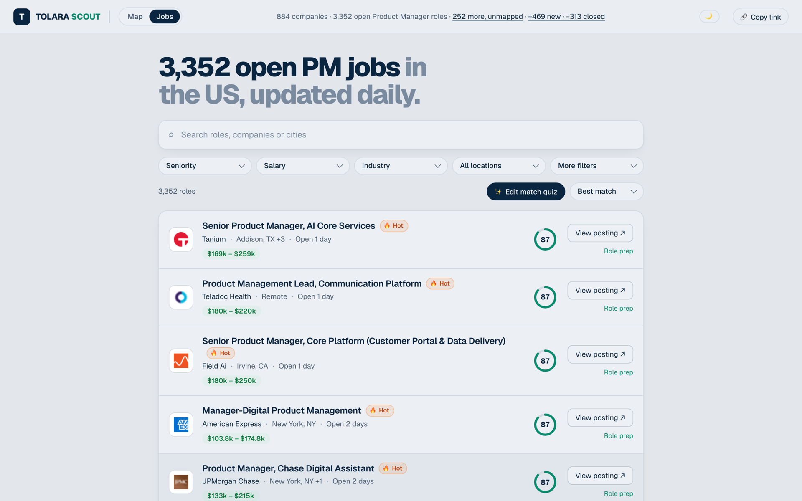
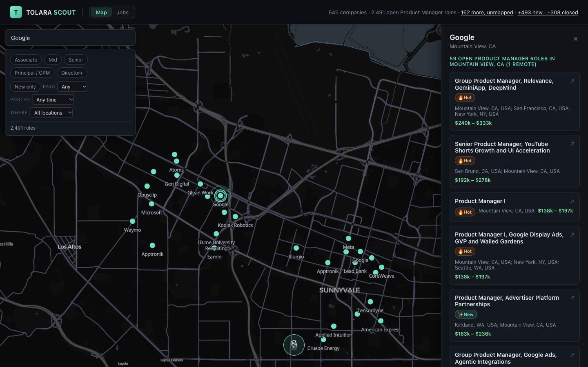
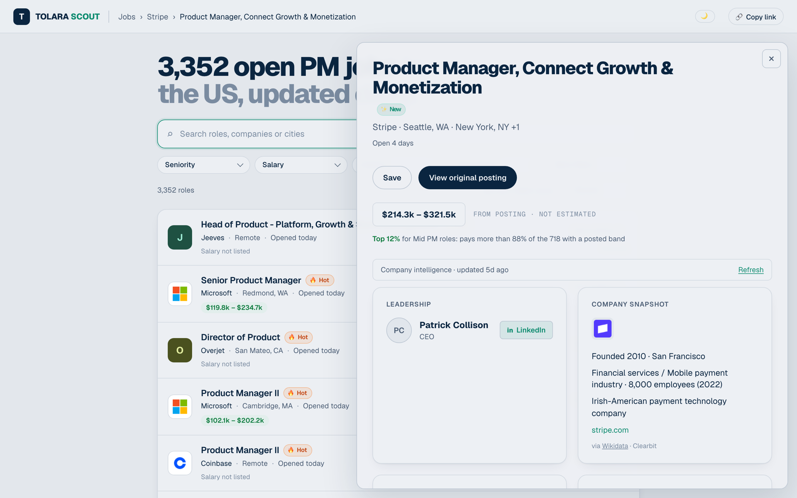

# Tolara Atlas

**Every open Product Manager job in the US, on one map. Updated every night. With the pay.**

2,979 PM roles at 677 companies hiring right now, read straight from each
company's own careers site. No reposts, no "promoted" listings, no
"competitive salary": 69% of roles show the real pay band.

[](https://github.com/GabeTHEGeek/tolara-atlas/actions/workflows/sync.yml)


> ⭐ **If this saves you an afternoon of tab-hopping, star the repo.** It's
> how other PMs find it.

---

## What's new

**November 2026: 155 new companies, +19% roles.** Oracle, Salesforce,
Adobe, Workday, ServiceNow, HPE, Mastercard, Zillow, Samsung, Intel, FanDuel,
The Trade Desk, Airwallex, Procore, Sierra, Mercor, Polymarket and 138 more
joined the map, adding 527 open PM roles. The board now covers **2,979
roles at 677 companies in 138 cities.**

Also new:

- 🏷️ **Industry filter.** 18 spaces, from AI labs to banks to gaming.
- 🎯 **Match scores in the app.** A score and tier badge on every role, a
  *Best match* sort, and a breakdown card on each role page.
- 🤝 **People to reach.** Recovers from model errors on its own, and a retry
  doesn't search again.

## Why this exists

Looking for a PM job means checking LinkedIn, Indeed and fifty careers pages,
and still not knowing:

- **Is this role still open?** Aggregators keep dead listings for months.
- **What does it pay?** Usually "competitive".
- **Who else is hiring in my city?** No job board shows you a map.
- **Am I a fit?** Keyword matching says yes to everything.

Tolara answers all four. It reads 1,361 companies' own hiring pages every
night, so a role is here only while it's actually open, at the office where
it's actually based, with the pay band the company published.

## Who's on it

**Big Tech:** Amazon · Google · Microsoft · Apple · Meta · NVIDIA · Netflix ·
TikTok · Oracle · Salesforce · Adobe · Workday · ServiceNow · HPE · Intel

**AI:** OpenAI · Anthropic · Perplexity · Scale AI · Cursor · Sierra · Harvey ·
Mercor · Runway

**Fintech & banks:** JPMorgan Chase · Capital One · American Express ·
Mastercard · FanDuel · Stripe · Coinbase · Robinhood · Plaid · Ramp · Brex · Affirm

**Consumer:** Airbnb · Pinterest · Reddit · Roblox · Spotify · Discord ·
Duolingo · DoorDash · Instacart · Lyft · Zillow · Expedia

**Software & data:** Snowflake · Databricks · Datadog · ServiceNow · Workday ·
Figma · Notion · Linear · Vercel · GitLab · Palantir

…and 1,300 more. Don't see your company?
[Add it in one line](#add-a-company-in-one-line).

## PM pay, from real postings

Middle of the posted pay band, for the 2,057 roles that publish one in USD:

| Level | Median |
|---|---|
| Associate / APM | **$123K** |
| Product Manager | **$200K** |
| Senior PM | **$209K** |
| Principal / Group PM | **$231K** |
| Director and above | **$234K** |

58% of banded roles pay $200K or more at the midpoint, and 151 pay $300K or
more. The highest band on the board goes up to **$1M**. These are posted
bands, not self-reported surveys.

**This week:** 361 roles added and 419 closed. The header shows what moved,
role by role.

## What you get

<table>
  <tr>
    <td width="50%"></td>
    <td width="50%"></td>
  </tr>
  <tr>
    <td align="center"><sub><b>Job board</b>: search, filters, pay and freshness</sub></td>
    <td align="center"><sub><b>Company view</b>: every role at one office</sub></td>
  </tr>
  <tr>
    <td colspan="2"></td>
  </tr>
  <tr>
    <td colspan="2" align="center"><sub><b>Role prep</b>: pay, leadership, company snapshot, hiring signals and news</sub></td>
  </tr>
</table>

🗺️ **A map, not a list.** One pin per office, sized by open roles. See who's
hiring PMs in Seattle, Austin or New York at a glance.

📋 **A job board too.** Search by title, company or city. Filter by level,
pay, industry, remote and posting date. Every role is tagged 🔥 Hot, ✨ New,
🧊 Aging or 🥶 Stale, so you apply while it's fresh.

🏷️ **18 industries.** AI labs, fintech, banks, health, gaming, devtools,
security and more. Narrow the whole map to the space you want.

🎯 **Resume match scores.** Score every live role against your resume on
domain, company stage, level, hard requirements, location and pay. Each
score comes with one line of evidence, so you can see why. Sort the board by
*Best match* and start at the top. Your resume stays on your machine.

🧠 **Interview prep for every role.** Company snapshot, leadership, recent
news, hiring trend, and what the role will actually focus on, quoted from
the posting.

🤝 **People to reach.** Find the hiring manager and team for a role, ranked
by how close they are to it. Runs locally, only when you ask.

🎙️ **Talk to the map.** *"Take me to New York."* *"Only senior roles over
$200K."* *"What would I actually be working on?"* Answers come from the
posting's own text, not the model's memory.

📈 **A change feed.** Every role opened and closed in the last week, so you
spot a team's hiring push before everyone else does.

## Built to be trusted

- **Straight from the source.** Every role links to the company's own
  posting. No middlemen, no reposts, no sponsored listings.
- **Pay is parsed, never guessed.** `$257K – $335K`, `208,000 USD - 327,750
  USD`, `$57–$70 per hour`. A 401(k) match is never mistaken for salary.
- **A blank beats a guess.** If a posting doesn't say it, neither do we.
- **Free data only.** The data pipeline has no paid dependencies.
- **Your data stays local.** Resumes, match scores and contacts live in a
  gitignored folder and are never committed.

## Run it yourself

Requires **Node 22**.

```bash
git clone https://github.com/GabeTHEGeek/tolara-atlas.git
cd tolara-atlas
npm install
npm run dev         # http://localhost:5173
```

The repo ships with last night's data, so the map works immediately: no
API keys and no sync needed.

**Fork it for your own search.** Point the matcher at your resume, and the
board sorts itself by fit:

```bash
npx tsx scripts/match-resume.ts .local/resume.txt
```

The voice copilot and People to reach are optional. Copy `.env.example` to
`.env` and add a model key (Gemini's free tier works). Six providers are
supported, and switching is one line.

<details>
<summary>All scripts</summary>

| Command | What it does |
|---|---|
| `npm run dev` | Dev server with the local APIs |
| `npm run sync` | Refresh every company's open roles |
| `npm run descriptions -- --minutes=20` | Fill in posting text and pay, time-budgeted |
| `npm run geocode` | Place each role on the map |
| `npm run prewarm` | Build company dossiers, time-budgeted |
| `npm run export` | Write the JSON the frontend reads |
| `npm run build` | Typecheck and build for production |
| `npx tsx scripts/match-resume.ts <resume>` | Score every role against a resume |

</details>

## Add a company in one line

Every tracked company is one row in
[`data/companies.csv`](data/companies.csv). If yours is on Greenhouse, Ashby,
Lever or Workday, it's a one-line pull request:

```csv
Your Company,yourcompany,greenhouse,verified,2026-11-14T00:00:00.000Z,Added by @you
```

The nightly sync picks it up, and it's on the map the next morning.

## Roadmap

- [ ] Hosted version, no clone needed
- [ ] Email alerts for new roles that match your filters
- [ ] More role families: engineering, design, data
- [ ] Hiring trends by company and city over time
- [ ] One-click resume upload for match scores

Ideas and pull requests are welcome. [Open an issue](https://github.com/GabeTHEGeek/tolara-atlas/issues).

## Under the hood

React, TypeScript and MapLibre on the front end; Node and SQLite behind it.
A GitHub Action refreshes the data every night and commits the result, so
the site itself is just static files.

```
server/
  ingestion/    careers-site connectors, pay parsing, geocoding, nightly sync
  enrichment/   company dossiers, leadership, news
  export/       static JSON the frontend reads
  agent/        voice copilot
  match/        resume matcher and scoring rubric
  contacts/     People to reach
src/
  components/   map, job board, filters, role pages, change feed, voice dock
```

---

<sub>Coverage figures are from the sync of November 14, 2026, and change every day.</sub>
