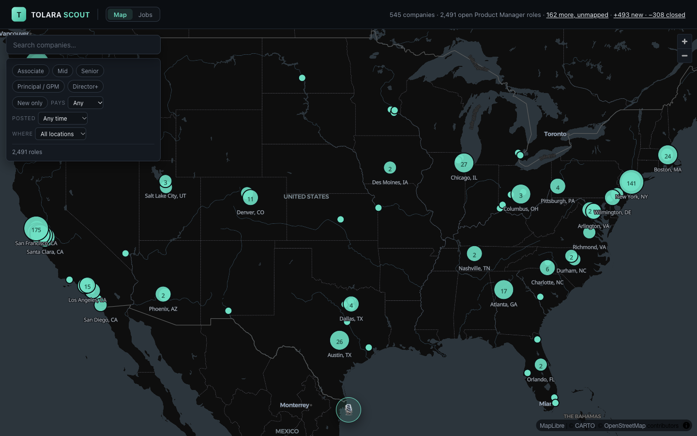
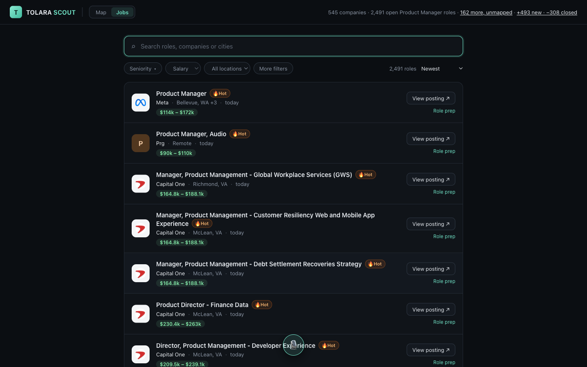
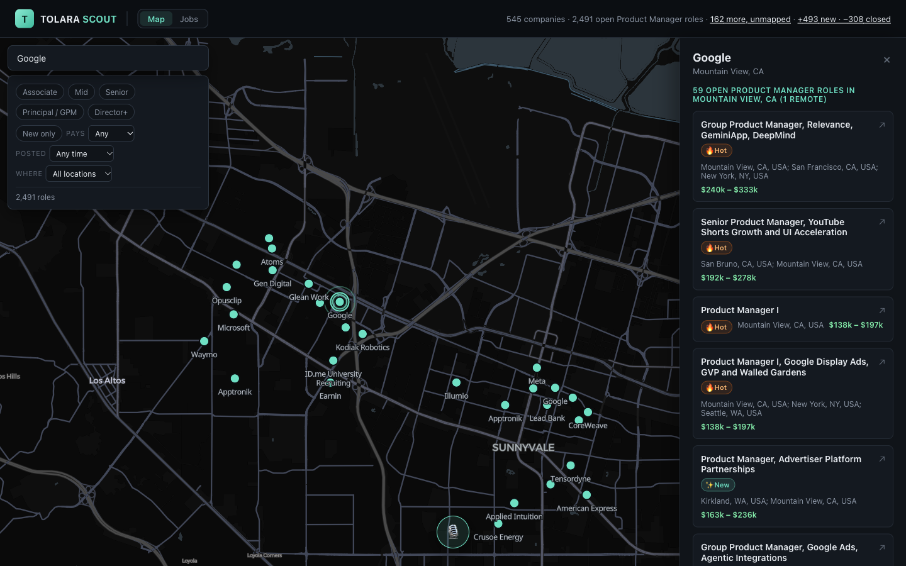
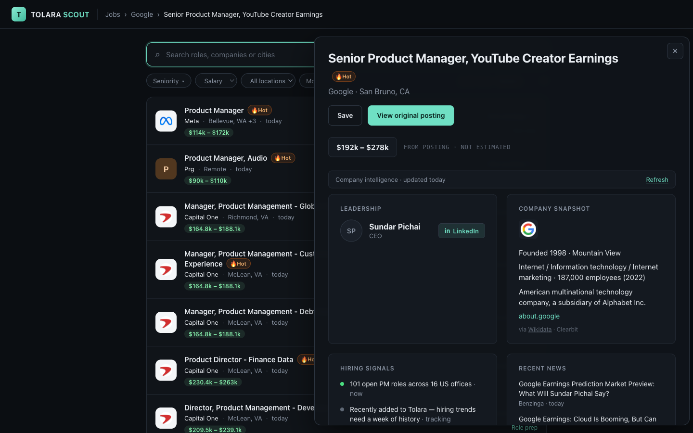

# Tolara Atlas

An interactive map and job board of open **Product Manager roles** in the US,
read straight from 1,200+ companies' own careers sites and refreshed every
night. Every figure on a role page is
quoted from a labelled source and can be checked against the original posting —
because the page exists to prepare for interviews, and a confident invention is
worse than a blank.

[](https://github.com/GabeTHEGeek/tolara-atlas/actions/workflows/sync.yml)




<table>
  <tr>
    <td width="50%"></td>
    <td width="50%"></td>
  </tr>
  <tr>
    <td align="center"><sub><b>Job board</b> — search, filters, pay and freshness</sub></td>
    <td align="center"><sub><b>Company view</b> — every role at one office</sub></td>
  </tr>
  <tr>
    <td colspan="2"></td>
  </tr>
  <tr>
    <td colspan="2" align="center"><sub><b>Role prep</b> — pay from the posting, leadership, company snapshot, hiring signals and news</sub></td>
  </tr>
</table>

---

## What it does

**A map, not a list.** One pin per *(company, office)* — a company hiring in
three cities gets three pins, each listing only the roles actually posted
there. Same-city pins are spread into a small jittered cloud so neighbours
stay individually clickable.

**A job board, too.** The same roles as a searchable list: search by title,
company or city, filter by seniority, salary and remote, sort by newest or
pay, and go straight to the posting or its role-prep page. Each role carries a
freshness tag — 🔥 Hot (three days or less), ✨ New, 🧊 Aging (30–59 days),
🥶 Stale (60+).

**Filters that narrow everything at once.** Seniority, salary floor,
posted-within, new-only and remote. Filtering runs once before render, so the
map, the search box, the company panel and the unmapped list can never
disagree about which roles exist.

**A change feed.** The sync has always recorded when a role was first seen,
when it was last seen, and whether it has closed. The header reports what moved
in the last week and opens a panel listing every addition and every closure.

**Interview-prep dossiers.** Company profile, leadership and recent news,
plus what the role is likely focused on — taken verbatim from the posting's own
"What you'll do" list wherever the board publishes one.

**A voice copilot.** Talk to the map: *"take me to New York"*, *"only senior
roles over two hundred thousand"*, *"what would I actually be working on?"*.
It answers from the posting's own text, never from the model's memory.
A copyable debug log records what it heard, which tools it called and where
the camera went.

**Resume matching (first pass).** Score every live role against a resume
with a custom rubric rather than keyword overlap: domain fit by product
type, company stage, level, hard requirements, location and pay, each with
one line of evidence, plus a cap for engineering roles wearing a PM title.
Runs as a script today while the rubric is calibrated by hand; the resume
and its report never leave `.local/`.

## How the data gets there

```
careers sites ──► sync ──► descriptions ──► geocode ──► prewarm ──► export ──► browser
(18 adapters)     SQLite   posting text      per-role    dossiers    map-data.json
                           and pay bands     lat/lng                 companies/*.json
```

Everything runs nightly in GitHub Actions and commits the result, so the site
itself is static files — no server required to browse it.

| Source | Used for |
|---|---|
| Greenhouse, Ashby, Lever, Workday, Oracle Recruiting Cloud, iCIMS, BambooHR, Paylocity, Eightfold, SmartRecruiters, plus Google / Apple / Meta / Amazon / Microsoft / TikTok / Atlassian / Booking.com adapters | Roles, posting text, locations, salary bands |
| Wikidata | Company snapshot, leadership |
| SEC EDGAR | Headquarters and industry for public companies |
| Clearbit | Domain and logo where Wikidata has nothing |
| Google News RSS | Recent headlines |
| Our own sync history | Hiring signals, new/closed roles |

All free. No paid data dependencies — see [Design notes](#design-notes).

## Running it

Requires **Node 22** (the native `better-sqlite3` build is version-specific; on
another major version run `npm rebuild better-sqlite3`).

```bash
npm install
npm run db:init     # create/migrate data/tolara.db
npm run dev         # http://localhost:5173
```

The repo ships a populated database and exported JSON, so `npm run dev` works
immediately without a sync.

### Scripts

| Command | What it does |
|---|---|
| `npm run dev` | Vite dev server, with the API middlewares mounted |
| `npm run sync` | Fetch every board, upsert roles, close stale ones |
| `npm run descriptions -- --minutes=20` | Fetch posting text (and pay) for boards whose lists omit it, time-budgeted |
| `npm run geocode` | Resolve each role's location to lat/lng |
| `npm run prewarm` | Fill the company-intelligence cache, time-budgeted |
| `npm run export` | Write `public/data/*.json` for the frontend |
| `npm run build` | Typecheck and build for production |
| `npx tsx scripts/test-salary-parsing.ts` | Table test for the salary parser |
| `npx tsx scripts/match-resume.ts .local/resume.txt` | Score every role against a resume; writes a report to `.local/` |

## The voice copilot

Optional, and off unless a provider key is set. Copy `.env.example` to `.env`
and add one:

```bash
TOLARA_AGENT_PROVIDER=deepseek      # or gemini | openai | openrouter | nvidia | opencode
DEEPSEEK_API_KEY=...
```

Six providers sit behind a single OpenAI-shaped `/chat/completions` client, so
switching is one line and no code change.

**Two speech transports, also swappable:**

- `TOLARA_VOICE_TRANSPORT=webspeech` *(default)* — the browser's built-in
  recognition and synthesis. Free; no audio leaves the machine until the
  transcript reaches the local API.
- `TOLARA_VOICE_TRANSPORT=realtime` — OpenAI speech-to-speech over WebRTC.
  Barge-in, a real voice, and a genuine output waveform, billed per minute of
  audio. The API key stays on the server; the browser gets a short-lived
  ephemeral token.

**How it's grounded.** The agent's action space is the app's own state —
`RoleFilters` and the router — so it cannot reach anything a click couldn't.
Lookups run server-side against SQLite and hand the model the posting's actual
text, because these roles were posted too recently to be in any model's
training data. The prompt requires a lookup before describing any role, and
"I don't have that" is a valid answer.

## Design notes

**Free sources only.** The pipeline has no paid dependencies. The voice
copilot is the one place a paid API may be used, and it is opt-in.

**Verifiability over completeness.** A blank card beats a plausible guess.
The resume matcher follows the same rule: a posting with no text to read is
scored as unconfirmed, never as a match.

**Salary bands are parsed, not estimated.** Boards write `$257K – $335K`,
`$156.6K`, `$145,760`, `208,000 USD - 327,750 USD`, `£194K`, `CA$140K`,
`₹30L` and `$57 – $70 per hour`. A lone figure only counts when the sentence
calls it pay, so a 401(k) match or a stipend is never read as salary.
All of it is normalised to real figures with an explicit period; hourly rates
are never converted to annual, because the posting never said how many hours.

**The database is a build artifact.** `data/tolara.db` is committed so the
site works from a clone, but it is regenerated nightly and should be treated
as derived rather than authored.

## Layout

```
server/
  ingestion/    board adapters, salary parsing, description backfill, geocoding, sync
  enrichment/   Wikidata, EDGAR, Clearbit, news, role focus, prewarm
  export/       static JSON the frontend reads
  agent/        voice copilot: tools, retrieval, providers, endpoints
  match/        resume matcher: rubric, archetypes, role analysis, scoring
  db/           schema and migrations
src/
  components/   map, job board, panels, filter bar, change feed, voice dock
  voice/        transports (Web Speech, Realtime) and the agent hook
```

## Current coverage

**2,491 roles** at **545 companies** across **125 cities**, from 1,205 tracked
boards. 105 of those companies list only remote or unmapped roles.
**1,646 roles (66%) publish a salary band**, and 581 are remote.
By seniority: 1,095 senior, 705 mid, 335 principal/GPM, 282 director+,
74 associate.
